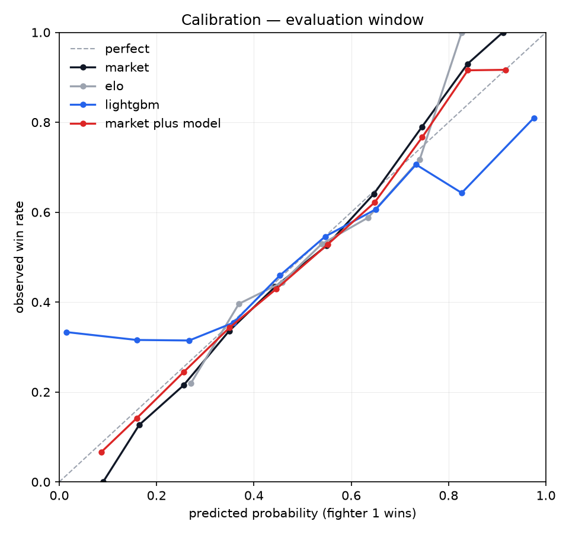
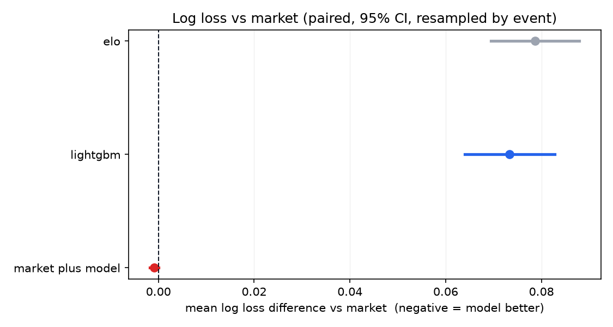
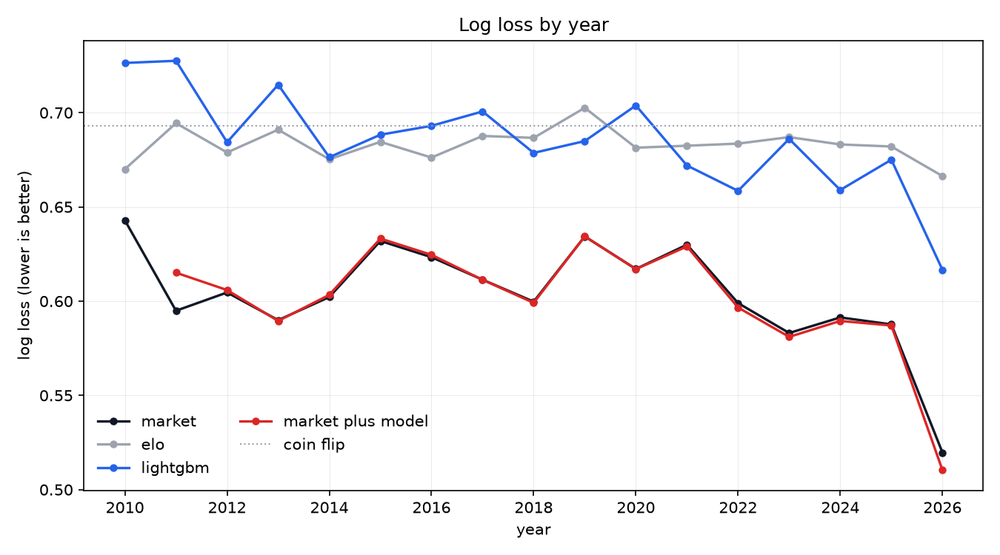
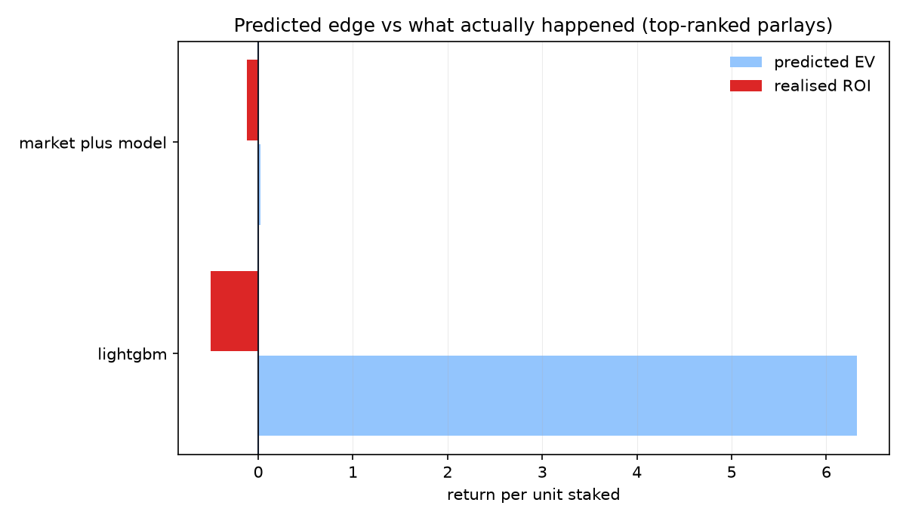
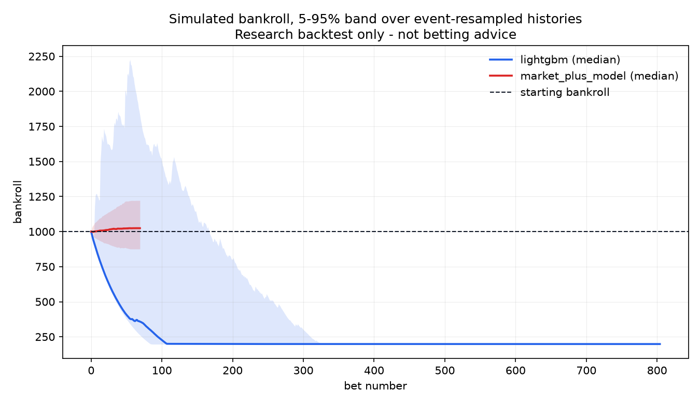
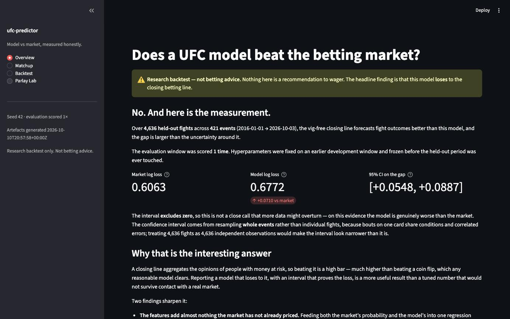
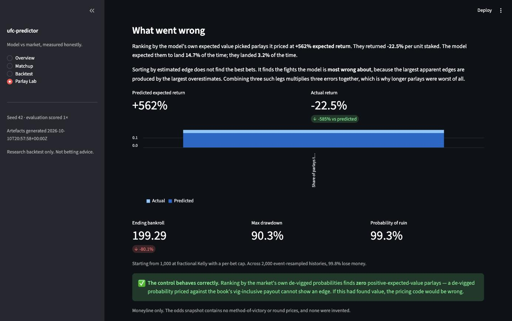

# ufc-predictor

A reproducible UFC fight-outcome model, evaluated walk-forward against the vig-free
betting market, with a Monte-Carlo parlay pricer.

> **Research backtest only. This is not betting advice, and nothing here should be used
> to wager.** The project exists to answer a measurement question honestly, not to
> produce picks.

<!-- HEADLINE:START -->
**Headline result: the model does not beat the closing line.** Over 4,636 held-out fights, the vig-free market scores 0.6063 log loss against the model's 0.6796 — a gap of +0.0734 with a 95% confidence interval of [+0.0640, +0.0828] that excludes zero. This is evaluation run 3, recorded in `reports/eval_runs.json`.
<!-- HEADLINE:END -->

**The window has been scored three times, and the first result was wrong.** Evaluation
run 1 used features that leaked each fighter's future career; a fresh-context review
found the leak, and run 2 removed it. A second review found LightGBM's calibrator claiming
literal certainty, and run 3 bounds it. Each fix was committed and pushed before its run
was scored. [Evaluation runs 1, 2 and 3](#evaluation-runs-1-2-and-3) shows all three side by side, with what each
fix changed and how it was found.

The full table, the by-year breakdown, and the calibration plot are below. Every figure
is generated by `make report` from files in `reports/`; none are typed by hand.

---

## The question

Closing betting lines are a strong, hard-to-beat forecast: the market aggregates
information from people with money at risk. So the question is not "can a model predict
UFC fights" — it is:

**Can a model built only from historical fight statistics beat the vig-free closing line,
out of sample, after honest accounting for uncertainty?**

The answer may well be no. A rigorous negative result is reported as readily as a
positive one, with confidence intervals on the difference rather than two point estimates
compared by eye.

---

## Non-negotiables

This project is built around four rules, because they are what make the result mean
anything:

1. **Point-in-time correctness.** Every feature for a fight is computable using only data
   dated strictly before that fight. Features are built with as-of joins over each
   fighter's prior bouts.
2. **Leakage tests are mandatory.** `tests/test_leakage.py` asserts no feature row uses an
   event dated on or after the fight it describes, and that the walk-forward training
   cutoff is respected on every fold. These were written *before* any model existed.
3. **Determinism.** All randomness is seeded from `config/config.yaml`. Same seed, same
   numbers. No seed literals in source.
4. **Fail loudly.** An unexpected data shape, a row-dropping join, or an unparseable date
   raises. Row counts are logged at every pipeline stage.

---

## Data sources

### Fight data — UFCStats, via a committed mirror snapshot

The canonical source for fights, per-round statistics, and fighter attributes is
[UFCStats](http://ufcstats.com). **It cannot be scraped directly from a clean
environment as of October 2026:** the site is behind a JavaScript proof-of-work
anti-bot challenge. A plain `requests` + BeautifulSoup fetch returns a ~3 KB
"Checking your browser…" stub containing an inline SHA-256 implementation, not fight
data — so a naive scraper appears to run successfully while producing nothing. The site
also serves HTTP only; port 443 refuses connections.

Rather than work around that, this project takes the route its own engineering rules
already require — the graded path must not depend on a live site being up — and reads a
**dated, committed snapshot** of a public UFCStats mirror:

| | |
|---|---|
| **Source** | [`Greco1899/scrape_ufc_stats`](https://github.com/Greco1899/scrape_ufc_stats) |
| **License** | GPL-3.0 (applies to that project's scraper code) |
| **Snapshot date** | 2026-10-09 (most recent event: UFC 332, 2026-10-03) |
| **Committed at** | `data/raw/ufcstats_snapshot_2026-10-09/` |

**No code from that repository is vendored or copied.** Its license covers its scraper
implementation; this project reads only the published CSV data — factual records of fight
results — and all parsing, normalization, and schema logic in `src/ufc_predictor/ingest/`
is written from scratch for this repo. Provenance, retrieval date, row counts, and
license are recorded in the snapshot's `SOURCE.md`.

### Closing odds

| | |
|---|---|
| **Source** | [`shortlikeafox/ultimate_ufc_dataset`](https://github.com/shortlikeafox/ultimate_ufc_dataset) |
| **License** | Apache-2.0 |
| **Coverage** | 2010-03-21 → 2026-03-28 |
| **Committed at** | `data/raw/odds_snapshot_2026-10-09/` |
| **Line type** | **Closing** — verified independently, see below |

#### Verifying these are closing lines

The upstream dataset documents neither the sportsbook nor when the price was captured,
and "the market baseline" means nothing if the prices are opening lines or, worse,
assigned after the fact. So the timing was established empirically rather than assumed:

- **Not post-fight.** Structurally, the upstream project publishes odds for bouts that
  have not happened yet. Empirically, the closing favourite wins 66.5% of the time across
  all 6,790 priced decisive fights — if the prices encoded known results it would be
  ~100%. (A full-sample property of the odds data, included as provenance evidence; it is
  not a model result, and no model metric is reported before Phase 4.)
- **Closing, not opening.** Matched against an independent source of per-sportsbook
  *at-close* moneylines ([`iankotliar/UFC_Final`](https://github.com/iankotliar/UFC_Final),
  `moneyline_data_at_close.zip`, derived from BestFightOdds across 12 books) over
  **3,812 jointly-covered fights**, these prices agree with the closing consensus to a
  **median absolute difference of 5 American odds points** — 71.5% within 10 points,
  88.2% within 25, and 97.4% agreement on which fighter was favoured.
- **Contrast with mid-week prices.** The same upstream project's `upcoming.csv`, captured
  during fight week, diverges much further from the committed values (Oliveira vs
  Chandler at UFC 309: −258 mid-week against −130 final), confirming the committed file
  is not a mid-week capture.

That dataset ships 118 columns, most of them precomputed career aggregates. Those are
**not used** — they are a leakage hazard, since it cannot be established that they exclude
the fight they describe or later ones. The loader whitelists exactly five columns
(both fighter names, the date, and both American moneylines) and a test enforces that
nothing else reaches the feature table. Every feature in this project is computed from
UFCStats with an explicit as-of join.

American odds are converted to implied probabilities and de-vigged by two-sided
normalization before any comparison. The market baseline is the vig-free favorite.

### Joining the two sources

Both sources key fights on fighter *names*, so the join is a correctness problem rather
than a formatting one: attaching one fighter's closing line to another fighter's result
would corrupt the market baseline without changing any row count. The policy is that a
**dropped row always beats a guessed pairing**, implemented as three tiers:

1. **Exact** match on (event date, normalized fighter pair) — 6,527 fights.
2. **Alias table** (`src/ufc_predictor/ingest/aliases.csv`) — 296 fights. The two sources
   disagree on names for three reasons: legal and married name changes (UFCStats carries
   a fighter's *current* name while the odds data uses the name used at the time, so
   "Tecia Torres" is "Tecia Pennington", "Cris Cyborg" is "Cristiane Justino", "Katlyn
   Chookagian" is "Katlyn Cerminara"), differing word order for many Chinese and
   Mongolian names, and ring names ("Rampage Jackson" / "Quinton Jackson").
   Each of the 64 aliases is **corroborated by at least two independent fights against
   different opponents** — Bobby Green → King Green is implied by 19 — and any name
   implying two different targets is rejected outright. Proposals are generated with
   evidence by `python -m ufc_predictor.ingest.propose_aliases` and reviewed by hand;
   single-evidence proposals were **not** accepted.
3. **Fuzzy**, a near-inert backstop requiring 0.92 similarity on *both* fighters plus a
   margin over the runner-up candidate. It resolves **1** fight in the whole dataset. A
   one-character surname typo scores ≈0.74 and is deliberately rejected, because a
   corroborated alias is far safer than a similarity score.

Every fuzzy match is logged to `reports/fuzzy_matched_odds.csv` and every failure to
`reports/unjoined_odds.csv`, both for audit. **80 priced fights (1.16%) remain unjoined**
and are dropped with a logged count; the pipeline raises if that share exceeds 5%.

---

## Point-in-time features

Every feature for a fight is computed from that fighter's bouts dated **strictly before**
the fight's event date. The builder makes this structural rather than incidental: state
is snapshotted per event-date, every fight on that date is described from the snapshot,
and only afterwards is the date's history folded in. Three consequences, each pinned by
a test:

- **Fights on the same card cannot see each other.** A card is simultaneous for a
  forecaster, so Elo and rolling statistics advance only once the whole event is
  processed. Flipping one bout's result changes no other bout on that date.
- **One-night tournaments are handled.** 67 fighter-days in this dataset hold more than
  one fight (up to four, in the 1994–99 format). A plain `shift(1)` over a fighter's
  fight sequence would leak the first bout of the night into the second; grouping by
  date does not.
- **A fight's own per-round statistics never enter its own features.** Scrambling one
  fight's round stats leaves that fight's feature row byte-identical.

**117 features**, all from the fight record: Elo (pre-fight), prior-fight count, win rate,
win and loss streaks, days since last fight, finish rate, and ten rate metrics —
significant strikes landed and absorbed per minute, striking accuracy and defence,
takedowns per 15 minutes, takedown accuracy and defence, submission attempts and
knockdowns per 15 minutes, and control time per minute — each over last-3, last-5, and
career-to-date windows, for both fighters plus the difference.

### What is *not* modelled, and why

There are **no injury, training-camp, short-notice, weight-cut, or social-media
features** in this project. Not because they would not help — several probably would —
but because **there is no data for them here.** Adding them would mean inventing numbers
and calling them measurements. The feature set is exactly what the committed fight
record supports, and nothing else.

**There is no height, reach or age.** Evaluation run 1 used all three, and they were
the leak: the only source is a tale-of-the-tape table scraped once, in 2026, whose blanks
mark fighters who were later cut. No dated source exists, so they are gone. A test blanks
every attribute in that table and asserts that no feature value moves.

**The closing line is never a feature.** The market is the baseline this project is
measured against, so letting it into the feature set would make "the model beats the
market" circular. A test asserts no odds-derived column can reach the feature table.

### Missing history is flagged, never zeroed

A debut fighter has no history. Encoding that as `0.0` strikes per minute would not read
as "unknown" to a model — it would read as "this fighter lands nothing", which is a
different and false claim. So every rate is `NaN` when its denominator is absent, and
two explicit flags carry the reason:

- `is_debut_{1,2}` — the fighter has no prior UFC bout (**2,812 fighter-slots**).
- `has_stats_history_{1,2}` — the fighter has prior bouts but no per-round statistics for
  them, which is common before 2001.

LightGBM splits on `NaN` natively, so missingness is information rather than a gap to be
filled. Backfilling from career totals was rejected outright: career totals include the
fight being predicted and every fight after it.

### How the 56 dropped ambiguous-name bouts affect opponents' histories

Nine fighter names in this snapshot are shared by more than one UFCStats fighter (two
different Mike Davises, two Bruno Silvas, and so on), so 56 bouts are dropped because the
participant cannot be identified. The effect on the fighters who *remain* was measured
rather than assumed:

- **Exactly 56 fighters each lose exactly one fight** from their recorded history — no
  fighter loses two.
- That is **56 of 17,734 fighter-slots (0.32%)**. The worst-affected fighter retains 75%
  of their history (3 of 4 bouts); most retain 85–95%.
- The error direction is **always understatement**: an affected fighter's prior-fight
  count, streaks, and rolling averages are computed from one fewer bout. No fight is
  fabricated and no future data is introduced, so the features stay point-in-time
  correct — they are simply built on marginally less history.

Dropping was preferred to guessing because merging two fighters' careers under one id
would corrupt every point-in-time feature for both, and would do so invisibly.

### Verifying there is no leakage

`tests/test_leakage.py` is the file that gates this project. Two tests carry most of the
weight because they are *behavioural* — they make no claim about the implementation and
cannot be satisfied by a convincing-looking code path:

**The mutation test.** Change a later fight's winner *and* scramble its per-round
statistics, rebuild everything, and assert that every feature row for a fight on or
before that date is **byte-identical**. It also asserts the mutation propagates *forward*,
so the test cannot pass by doing nothing.

**The shuffle test.** Randomize who won every fight, rebuild every feature from the
shuffled results — Elo, streaks, win rates, rolling statistics and all — then train and
evaluate. If any feature peeked at the fight it describes, the model would still predict
the shuffled outcome.

<!-- DIAGNOSTICS:START -->
Run entirely inside the dev window (train 1994 → 2013-10, test 2013-10 → 2015-12, n = 1,033) with LightGBM on the frozen hyperparameters, a fixed 200 trees, no early stopping or calibration. The held-out period is never touched by a diagnostic:

| Outcomes | AUC | Log loss |
|---|---|---|
| **Shuffled** (mean of 8 draws) | **0.4992** (sd 0.0194, range 0.473–0.528) | **0.726** (range 0.714–0.739) |
| *Chance* | *0.5000* | *0.6931* |
| **Real (control)** | **0.5863** | **0.7083** |

Shuffled outcomes collapse to chance AUC, and the control sits 4.5 shuffle standard deviations above them, so real outcomes stay learnable. Every shuffled draw's log loss is worse than chance. On real outcomes this fixed, uncalibrated model is overconfident: its log loss is worse than chance even though it ranks fights better than chance, so here the separation between shuffled and real outcomes is carried by AUC, not log loss.
<!-- DIAGNOSTICS:END -->

The control matters as much as the test: without it, a broken pipeline producing pure
noise would pass the shuffle test trivially.

At n ≈ 1,000 a single AUC estimate carries a standard error of about 0.016, so one draw
can read 0.53 with no leakage at all. The committed test therefore averages three
independent shuffles, asserting that their mean AUC sits at chance and that none of their
log losses beats chance. Since the re-tune, the real-outcome control's log loss is also
worse than chance, so only AUC now separates real from shuffled outcomes, and the control
test asserts on AUC accordingly. The table
is produced by `uv run ufc-predictor diagnose`, which shares its code with the tests.

**What these tests could not see.** Both behavioural tests mutate fights and round
statistics; neither touched the fighters table, which is how run 1's leak got past them —
every leakage test passed while it was live. Two tests now cover it, and both failed on
the run-1 code: `test_features_ignore_the_scrape_time_fighter_attributes` blanks every
attribute in the fighters table and asserts no feature moves, and
`test_a_blank_feature_never_predicts_who_loses` checks, for every paired feature, that
the side with a blank value wins a plausible share of dev-window bouts. Debutants'
legitimately blank history passes it; run 1's blank reach did not.

*These are leakage diagnostics on a simple chronological split, **not** project results.*
The honest evaluation is the walk-forward backtest, which is also the only thing
permitted to report an eval-window number.

---

## Results

<!-- RESULTS:START -->

### Results — held-out evaluation window

Walk-forward over **421 events / 4,636 fights** (2016-01-01 → 2026-10-03). Hyperparameters frozen from the dev window; **62 refits** at a cadence of every 10 events. Seed 42. Evaluation runs to date: **3**.

| Model | n | Log loss | Brier | AUC | Accuracy | ECE |
|---|---:|---:|---:|---:|---:|---:|
| Market (vig-free closing line) | 4,636 | **0.6063** | 0.2096 | 0.7319 | 0.6670 | 0.0240 |
| LightGBM | 4,636 | **0.6796** | 0.2419 | 0.6061 | 0.5759 | 0.0129 |
| Elo | 4,636 | **0.6849** | 0.2459 | 0.5732 | 0.5535 | 0.0164 |
| Market + model *(variant)* | 4,636 | **0.6054** | 0.2094 | 0.7315 | 0.6650 | 0.0206 |

### Does any model beat the market?

Paired per-fight log-loss difference against the market, with a 95% confidence interval from 10,000 bootstrap resamples **of events, not fights** (421 events). Negative means the model is better.

| Model | Δ log loss vs market | 95% CI | Verdict |
|---|---:|---|---|
| LightGBM | +0.0734 | [+0.0640, +0.0828] | market wins |
| Elo | +0.0786 | [+0.0694, +0.0879] | market wins |
| Market + model *(variant)* | -0.0009 | [-0.0018, -0.000004] | lower than the market; see [the control](#what-the-variants-gain-is-made-of) |

**Reading this honestly:**

- The closing line **beats** the feature-based model by 0.0734 nats per fight. The model does not beat the market, and this is the project's headline result.
- The market-anchored variant scores -0.0009 against the market (CI [-0.0018, -0.000004]). It takes the closing line as an input, so this cannot show an edge over that line; whether any of the difference comes from the model is tested by [the control](#what-the-variants-gain-is-made-of) after this section.
- How much that is worth: 0.0009 nats is 0.15% of the market's own log loss. Unadjusted p = 0.048; Bonferroni-adjusted across the 3 comparisons, p = 0.145. In the dev window the same variant scored +0.0008 (CI [-0.0015, +0.0031]).
- LightGBM scores worse than a coin flip in the dev window (0.6986 against ln 2 = 0.6931), yet ranks fights better than chance (AUC 0.5852): its probabilities are too confident, not inverted.

### Window reconciliation

Every priced, decisive fight is accounted for: **2,154 dev + 0 gap + 4,636 eval = 6,790 scored**, plus 0 unscored during walk-forward warm-up, totalling 6,790.

| Window | Span | Events | Fights | Market log loss | LightGBM log loss |
|---|---|---:|---:|---:|---:|
| Dev (tuning) | 2010-01-01 → 2015-12-31 | 198 | 2,154 | 0.6098 | 0.6986 |
| Eval (held out) | 2016-01-01 → 2026-10-03 | 421 | 4,636 | 0.6063 | 0.6796 |

### Log loss by year

| Year | Fights | Market | LightGBM | Elo | Market + model |
|---:|---:|---:|---:|---:|---:|
| 2010 | 209 | 0.6429 | 0.7264 | 0.6700 | — |
| 2011 | 292 | 0.5949 | 0.7275 | 0.6944 | 0.6151 |
| 2012 | 329 | 0.6046 | 0.6843 | 0.6789 | 0.6059 |
| 2013 | 372 | 0.5899 | 0.7148 | 0.6910 | 0.5895 |
| 2014 | 491 | 0.6022 | 0.6764 | 0.6753 | 0.6033 |
| 2015 | 461 | 0.6319 | 0.6883 | 0.6845 | 0.6332 |
| 2016 | 479 | 0.6233 | 0.6930 | 0.6762 | 0.6246 |
| 2017 | 438 | 0.6114 | 0.7007 | 0.6877 | 0.6113 |
| 2018 | 468 | 0.5997 | 0.6787 | 0.6866 | 0.5991 |
| 2019 | 491 | 0.6343 | 0.6849 | 0.7026 | 0.6344 |
| 2020 | 428 | 0.6171 | 0.7038 | 0.6814 | 0.6170 |
| 2021 | 476 | 0.6300 | 0.6720 | 0.6825 | 0.6290 |
| 2022 | 483 | 0.5990 | 0.6585 | 0.6836 | 0.5966 |
| 2023 | 406 | 0.5831 | 0.6861 | 0.6870 | 0.5811 |
| 2024 | 373 | 0.5914 | 0.6590 | 0.6832 | 0.5895 |
| 2025 | 484 | 0.5877 | 0.6750 | 0.6821 | 0.5871 |
| 2026 | 110 | 0.5197 | 0.6166 | 0.6664 | 0.5104 |







*Generated from `reports/metrics.json` (git `42c7d5e`, 2026-10-13T09:42:29+00:00) by `make report`. No figure above is typed by hand.*

<!-- RESULTS:END -->

<!-- POSTHOC:START -->
### What the variant's gain is made of

*A post-hoc check on the stored predictions, prompted by the second review ([`reports/review_run2.md`](reports/review_run2.md)). No evaluated model is refitted; the market-only control is new, and is listed in the glimpse disclosure.*

The variant is a walk-forward logistic stacker on the market's and LightGBM's log-odds. Replaying that protocol on the stored predictions reproduces every variant prediction exactly; replaying it on the market's log-odds alone separates what the market contributes from what the model adds.

| Comparison on the 4,636 eval fights (paired, event-resampled) | Δ log loss | 95% CI | p |
|---|---:|---|---:|
| Market recalibrated on its own past errors, vs the vig-free market | -0.0009 | [-0.0016, -0.0001] | 0.018 |
| Market + model, vs the recalibrated market | -0.00003 | [-0.0005, +0.0004] | 0.889 |
| Market + model, vs the vig-free market (as reported above) | -0.0009 | [-0.0018, -0.000004] | 0.048 |

Adding LightGBM to the recalibrated market changes nothing that can be told from zero, and the stacker weights LightGBM's log-odds at 0.042–0.082 against 1.00–1.10 for the market's. **The variant's gain is the closing line correcting itself, not information from the features.** Proportional de-vig leaves a favourite–longshot bias, which a recalibration slope of 1.02–1.11 undoes. So the vig-free baseline used throughout this README is slightly beatable without any model: it is a marginally *easier* bar than a recalibrated reading of the same closing line, and the feature model still fails to clear it.

### Where LightGBM's excess log loss comes from

| Run | Window | Fights | Exactly 0 or 1 (within 1e-05) | Of those, wrong | At the calibration bound | Of those, wrong | LightGBM log loss |
|---:|---|---:|---:|---:|---:|---:|---:|
| 2 | Dev | 2,154 | 25 | 9 | — (no bound) | — | 0.7370 |
| 2 | Eval | 4,636 | 26 | 6 | — (no bound) | — | 0.6916 |
| 3 | Dev | 2,154 | 0 | 0 | 25 | 9 | 0.6986 |
| 3 | Eval | 4,636 | 0 | 0 | 26 | 6 | 0.6796 |

Each walk-forward fold calibrates LightGBM with isotonic regression, a step function. When its most extreme step holds only wins or only losses it outputs exactly 1 or 0, which scoring clips to 1e-06; a miss then costs 13.8 nats, 20 times what a coin flip pays. Run 3 bounds the calibrator to [0.01, 0.99], so no prediction claims certainty; the same extremes now sit at the bound, where a miss costs 4.6 nats. LightGBM scores 0.6986 in the dev window, still slightly worse than a coin flip, and 0.6796 on eval, still far behind the market's 0.6063.
<!-- POSTHOC:END -->

---

<!-- PARLAY:START -->

### Parlay pricing — how much of the edge was real?

> **Research backtest only. Not betting advice.** Nothing here should be used to wager. The point of this section is to *falsify* an apparent edge, not to find one.

Priced on the **stored out-of-sample predictions** from the walk-forward backtest — evaluation run 3's predictions. Pricing them scores nothing new, so the eval ledger does not move. 421 cards, 4,636 fights, 10,000 seeded simulations per card, up to 3 legs, staked at 0.25x Kelly capped at 2% of bankroll.

**Only real moneyline prices are used.** Moneyline only. The odds snapshot contains no method-of-victory or round prices, and none were invented.

Each simulation resolves every fight on the card once and evaluates all legs against that same draw, so two legs from one bout are exactly dependent: backing both fighters gives a joint probability of zero rather than the product of two probabilities. Across different bouts the model treats fights as conditionally independent, and that assumption is measured rather than asserted — the correlation between same-card residuals is **+0.0013** over 24,069 pairs.

Predicted EV, realised ROI and both hit rates are per unit at flat stakes over all top-ranked parlays. The bankroll replay stakes Kelly-sized amounts only on those that clear the stake threshold, in date order, and stops if the bankroll is ruined.

| Ranked by | Candidates | Top-ranked | Cleared stake threshold | Placed in bankroll replay | Predicted EV | Realised ROI | Hit rate | Predicted hit rate |
|---|---:|---:|---:|---:|---:|---:|---:|---:|
| lightgbm | 83,265 | 1,261 | 1,261 | 250 | **+6.3207** | **-0.5057** | 0.0206 | 0.1321 |
| market plus model | 408 | 192 | 53 | 53 | **+0.0197** | **-0.1189** | 0.5052 | 0.5654 |
| market | 0 | 0 | 0 | 0 | — | — | — | — |

**The headline of this section.** Ranking by the model's own expected value selected parlays it priced at **+632.1% expected return**. They actually returned **-50.6%** per unit staked. The model expected those parlays to land 13.2% of the time; they landed 2.1% of the time.

That gap is the whole lesson. Ranking by estimated edge does not select the best bets — it selects the fights the model is most *wrong* about, because the biggest apparent edges come from the largest overestimates. Multiplying three such legs together compounds the error, which is why the three-leg parlays are the worst of all.

A £1000 bankroll staked this way places 250 of the 1,261 qualifying bets before it is ruined, and ends at **£199.02** (-80.1%) with a maximum drawdown of 94.0%. Resampling whole events 2,000 times gives a 90% band of £196 to £200; **100.0% of histories lose money** and **100.0% hit ruin** (defined as falling to 20% of the starting bankroll).

**The market-anchored variant** ranks only 192 parlays, of which 53 clear the stake threshold. At flat stakes those 53 returned -10.2% per unit, and all 192 returned -11.9%. Staked by the bankroll replay, its bankroll ends at **£1,027.50** (+2.7%); resampling whole events 2,000 times gives a 90% band of £876 to £1,221, and **40.5% of histories lose money**. The band contains the starting bankroll, so this cannot be distinguished from breaking even. It also takes the closing line as an input, so it cannot show an edge *over* that line on its own.

**The control works.** Ranking by the market's own de-vigged probabilities finds **zero** positive-EV parlays, which is exactly right: a de-vigged probability priced against the book's vig-inclusive payout cannot show an edge. If this row had found value, the pricing code would be wrong.





*Generated from `reports/parlay_metrics.json` by `make parlay`.*

<!-- PARLAY:END -->

---

## Evaluation runs 1, 2 and 3

The held-out window has been scored three times. Each run fixed one defect that an
adversarial review found in the one before, each fix was committed and pushed before its
run was scored, and the ledger (`reports/eval_runs.json`) names every run's commit.

### All three runs side by side

<!-- RUNS:START -->
All on the same 4,636 evaluation fights. Each column is generated from that run's own `metrics.json`; earlier runs are archived under `reports/archive/`.

| Figure | Run 1 (leaky features) | Run 2 (leak fixed) | Run 3 (calibrator bounded) |
|---|---:|---:|---:|
| Eval log loss — Market (vig-free closing line) | 0.6063 | 0.6063 | 0.6063 |
| Eval log loss — LightGBM | 0.6772 | 0.6916 | 0.6796 |
| Eval log loss — Elo | 0.6849 | 0.6849 | 0.6849 |
| Eval log loss — Market + model *(variant)* | 0.6030 | 0.6054 | 0.6054 |
| Eval Δ vs market — LightGBM | +0.0710 [+0.0548, +0.0887] | +0.0853 [+0.0703, +0.1020] | +0.0734 [+0.0640, +0.0828] |
| Eval Δ vs market — Elo | +0.0786 [+0.0694, +0.0879] | +0.0786 [+0.0694, +0.0879] | +0.0786 [+0.0694, +0.0879] |
| Eval Δ vs market — Market + model *(variant)* | -0.0033 [-0.0069, +0.0006] | -0.0009 [-0.0017, -0.00004] | -0.0009 [-0.0018, -0.000004] |
| Dev log loss — LightGBM | 0.6675 | 0.7370 | 0.6986 |
| Dev Δ vs market — Market + model *(variant)* | -0.0220 [-0.0305, -0.0130] | +0.0011 [-0.0012, +0.0034] | +0.0008 [-0.0015, +0.0031] |
| Parlays ranked by LightGBM — top-ranked | 1,263 | 1,261 | 1,261 |
| Parlays ranked by LightGBM — placed in bankroll replay | 208 | 250 | 250 |
| Parlays ranked by LightGBM — predicted EV, flat stakes | +562.0% | +632.3% | +632.1% |
| Parlays ranked by LightGBM — realised ROI, flat stakes | -22.5% | -50.6% | -50.6% |
| Parlays ranked by LightGBM — ending bankroll (from £1,000) | £199.29 | £198.82 | £199.02 |
| Parlays ranked by market + model — top-ranked | 1,196 | 55 | 192 |
| Parlays ranked by market + model — placed in bankroll replay | 1,124 | 29 | 53 |
| Parlays ranked by market + model — predicted EV, flat stakes | +27.1% | +3.6% | +2.0% |
| Parlays ranked by market + model — realised ROI, flat stakes | -7.3% | +9.6% | -11.9% |
| Parlays ranked by market + model — ending bankroll (from £1,000) | £826.70 | £1,057.80 | £1,027.50 |
<!-- RUNS:END -->

### Run 1 → run 2: the features leaked the future

#### What leaked

Run 1 gave the model each fighter's height, reach and age. Those come from UFCStats'
tale-of-the-tape table, and the only copy is a single scrape taken in 2026. UFCStats
fills those fields in for fighters who stayed on the roster; for many who were cut after
a fight or two they are blank. So a blank reach did not mean "unknown" — it meant "this
fighter's UFC career is about to end", which mostly means "this fighter loses". That is
information from after the fight, and LightGBM, which splits on missing values natively,
learned to use it.

#### How it was found

Not by the test suite. Every leakage test passed with the leak live, because each one
perturbed fights or round statistics and none perturbed the fighters table. It was found
by the adversarial review this project mandates once the work is finished: a
fresh-context reviewer whose only brief was to hunt for leakage and overfitting. Its full
report is [`reports/review.md`](reports/review.md). The finding was reproduced
independently before anything was changed.

#### The fix, and why it is the strong one

The obvious patch — blank the attribute for both fighters whenever either is missing —
does not work, and the evidence below shows why: whether a pair *has* a blank, combined
with how experienced each fighter is, still identifies the fighter who was later cut. So
all three attributes were dropped (126 → 117 features). Two regression tests were written
first, watched failing on the run-1 code, and now guard the fix.

Apart from the re-tune the fix forced, nothing else changed, so the difference between
the runs is attributable to the fix:
same features otherwise, same tuning grid and tie rule, same walk-forward, same seed. Elo,
which never used the attributes, scores identically in both runs — a built-in check that
nothing else moved.

#### How run 2 was kept honest

1. LightGBM was re-tuned inside the dev window only, because its run-1 settings had been
   chosen on an objective that rewarded the leak.
2. The new settings were committed and pushed (`75bab69`) **before** the evaluation window
   was scored, and CI was green on that commit.
3. Run 2 was scored from a clean working tree at exactly that commit. Its ledger entry
   records the full commit hash, that the tree was clean, and why the run happened, and a
   test checks that the hyperparameters in `metrics.json` are the ones in
   `config/config.yaml` at that commit.

Run 1 cannot meet that bar, and should be read accordingly. It is stamped `1c1e1f0`, but
that commit contains none of the backtest code: the walk-forward engine, the metrics and
bootstrap, and the report generator were first committed about seven minutes after the
run (`4ebb622`, `d3ba0ca`, `496a8e4`), together with one fitting setting it used,
`min_validation_rows: 200` (`ab82faf`).

<!-- LEAK:START -->
**Evidence, dev window 2010-01-01 → 2015-12-31** (2,198 decisive bouts):

| Attribute (as run 1 used it) | Bouts where only one fighter's value is blank | Blank side's win rate |
|---|---:|---:|
| Reach | 334 | 5.7% |
| Age (from date of birth) | 8 | 12.5% |
| Height | 3 | 0.0% |

Blanking both sides would not have closed the leak. In pairs with a one-sided blank the less-experienced fighter won **23.2%** of 211 bouts, against **48.4%** of 1,568 complete pairs, so "this pair has a blank" plus prior experience still points at the fighter who was later cut.
<!-- LEAK:END -->

### Run 2 → run 3: the calibrator claimed certainty

#### What was wrong

The second review ([`reports/review_run2.md`](reports/review_run2.md)) found that
LightGBM's isotonic calibrator — a step function fitted on each fold's small
chronological tail — sometimes ended in a step holding only wins or only losses, and so
output a probability of exactly 0 or 1. A miss on such a prediction costs 13.8 nats,
twenty times what a coin flip pays, and a few dozen of them made LightGBM look worse than
a coin flip in the dev window. [The audit](#where-lightgbms-excess-log-loss-comes-from)
has the counts for runs 2 and 3.

#### The fix: a bound fixed in advance

The calibrated probability is bounded to [0.01, 0.99]. The pair was chosen a priori as a
loose, round bound — not searched over — and justified from dev-window data only:

<!-- CALBOUND:START -->
**Evidence for [0.01, 0.99], dev window 2010-01-01 → 2015-12-31** (2,154 priced fights; the bound was fixed before this was computed, and was not searched):

| Dev-window fact | Value |
|---|---:|
| Most extreme vig-free closing probabilities | 0.070 and 0.921 |
| Fights where the closing line itself fell outside the bound | 0 |
| Favourites priced at 0.85 or more: bouts, share they lost | 72, 8.3% |
| The top 1% of favourites (priced 0.883+): bouts, share they lost | 21, 4.8% |
| Cost of one miss, unbounded → at the bound | 13.8 → 4.6 nats |

The bound sits outside anything the closing line or the outcomes support, so it removes only literal certainty; it never constrains a prediction the market would consider plausible.
<!-- CALBOUND:END -->

Nothing else changed. The hyperparameters are run 2's — tuning fits without calibration,
so the bound cannot affect it — and Elo, the market and every fold boundary are
identical, as the side-by-side table shows. Two regression tests were written first and
watched failing on the run-2 code: one fits the calibrated model on a near-separable
fixture, where most predictions came out at exactly 0 or 1, and asserts none now do; the
other asserts that every calibrated probability lies inside the configured bound.

#### How run 3 was kept honest

1. The bound and its tests were committed and pushed (`42c7d5e`) **before** the
   evaluation window was scored, and CI was green on that commit.
2. A dev-only dry run at that commit confirmed every fold still calibrates and every
   prediction stays inside the bound, without touching the evaluation window.
3. Run 3 was scored from a clean tree at `42c7d5e`, after rebuilding its inputs from the
   committed snapshot. Its ledger entry records the commit, the reason, and digests of
   the inputs.

### What it means

- **The headline survives every fix.** The leak made the model look *better*; removing
  it widened the market's margin, and bounding the calibrator narrowed it again without
  coming close to closing it.
- **The market-anchored variant's dev-window win was the leak.** Run 1 reported that
  adding the model to the closing line beat the line in the dev window, with an interval
  excluding zero; without the leak that disappears. Its small remaining eval-window gain
  is the closing line recalibrating itself, and the model adds nothing to it ([the
  control](#what-the-variants-gain-is-made-of)).
- **LightGBM no longer claims certainty.** Run 3's bound removes every literal 0 or 1
  and cuts the cost of each confident miss by two-thirds. The leak had hidden the defect
  in run 1, and the dev-window dry run before run 2 showed the symptom without it being
  traced. LightGBM is still slightly worse than a coin flip in the dev window, because
  some of the bounded extremes still miss
  ([details](#where-lightgbms-excess-log-loss-comes-from)).
- **The variant's parlays stay few and noisy.** Without the leak it believes far fewer
  parlays are positive-EV than in run 1, and the [parlay
  section](#parlay-pricing--how-much-of-the-edge-was-real) gives the bootstrap band on
  what remains.

---

## Interface

### CLI

```bash
uv run ufc-predictor predict --event "Adesanya vs. Pyfer"   # write a prediction log
uv run ufc-predictor settle reports/predictions/<log>.csv   # fill results, score it
uv run ufc-predictor export-app                             # artefacts for the demo
```

`predict` writes a timestamped CSV — event, fighter pair, model probability, vig-free
market probability, the real moneylines, and the result once known — plus a JSON sidecar
recording the git SHA, the seed, and how the probabilities were produced. `settle` fills
in results, computes per-fight log loss, and reports the model against the market on that
card.

**Upcoming fights and odds are never invented.** `predict` will only write a log for an
event that exists in the committed snapshot. No live source of upcoming cards is
reachable: UFCStats answers with a JavaScript proof-of-work challenge, and the odds
project's `upcoming.csv` has been stale since 2026-04-04. Every log in this repository is
therefore a **replay** of a completed event, labelled `mode: replay`.

> **What a replay log does not prove.** The predictions themselves are honest — for any
> event inside the backtest they come from a model trained only on strictly earlier
> fights, so they are genuinely out of sample. But the result was already known when the
> file was written, so **its commit timestamp cannot demonstrate foresight**, and each log
> records `"proves_advance_commitment": false` to say so. The mechanism is in place for
> the live case: when a future card becomes reachable, the same command writes
> `mode: live` with that flag true, and committing the file before the event is what makes
> the timestamp meaningful. Claiming otherwise for a replay would be the easiest and most
> tempting dishonesty in this project, so it is called out rather than glossed.

### Streamlit demo

```bash
make app
```

Four pages: **Overview** (leads with the negative result), **Matchup** (model vs market
for any pairing, with hypothetical bouts explicitly marked as having no market price),
**Backtest** (metrics, calibration, the year-by-year gap) and **Parlay Lab** (predicted
edge against realised return, framed as a demonstration of selection bias).

The app **loads precomputed artefacts only** — it never trains, scrapes or re-scores, so
it starts instantly and cannot disagree with the committed results. Its dependencies live
in `app/requirements.txt` and are a strict subset of the research project's: no DuckDB,
matplotlib, Typer, requests or BeautifulSoup. A test parses the app's imports with `ast`
and fails if anything undeclared creeps in.

Verified with Streamlit's own `AppTest` harness (tests covering all four pages, the
persistent banner, the hypothetical-matchup labelling and the selection-bias framing) plus
manual checks against the Web Interface Guidelines: content reflows with **zero overflow at
390 px**, headings are hierarchical with a single `h1`, and `color-scheme` and
`theme-color` are set from the rendered background so dark mode is correct rather than
merely dark-ish. Charts are drawn natively so they follow the viewer's theme; no
pre-rendered images with baked-in white backgrounds are embedded.






---

## Models

Three models behind one interface — `fit(X, y)` and `predict_proba(X) -> P(fighter_1
wins)`. The shared interface is a fairness mechanism, not tidiness: the backtest cannot
give one model a different fitting regime, a different clipping rule, or a different set
of fights to be scored on.

| Model | What it uses | Fitted? |
|---|---|---|
| **Market baseline** | the de-vigged closing line | No — the price is an observation, not something learned |
| **Elo** | pre-fight rating gap | A single logistic coefficient |
| **LightGBM** | all 117 point-in-time features | Yes, with early stopping and calibration |

Elo deliberately does *not* use the raw `1 / (1 + 10^(-gap/400))` curve: that curve's
sharpness depends on the K-factor chosen when building the ratings, not on how predictive
a rating gap turns out to be. A one-feature logistic lets the data set that.

### Tuning discipline

Hyperparameters were selected **inside the dev window only** (2010 → 2015), by
`uv run ufc-predictor tune`, then **frozen in `config/config.yaml`**. The backtest reads
them and never re-tunes — hyperparameters chosen against the evaluation period would turn
it into a second training set.

- **No random cross-validation anywhere.** Validation is always a chronological holdout:
  the most recent slice of the training data. Random K-fold would put future fights in
  the training folds of past ones, and the resulting score would be optimistic in a way
  that does not survive deployment. `LightGBMModel.fit` *raises* if given unsorted rows
  or a frame with no `date` column, so a random split cannot happen silently.
<!-- TUNING:START -->
- **216 candidates searched**, biased toward strong regularization, on a chronological holdout inside the dev window (train 2,581 fights, validate 860 fights 2014-03-23 → 2015-12-19). Selected: `max_depth=6`, `num_leaves=31`, `min_child_samples=80`, `learning_rate=0.05`, `colsample_bytree=0.7`, `reg_lambda=1.0`. Early stopping kept 31 trees on the tuning split.
- Its validation log loss is **0.6775**; a coin flip scores 0.6931, and the settings in force before this search scored 0.6825 on the same split.
- **Ties are broken by a coded rule, not by the score.** 2 candidates scored within 0.001 log loss of the best, which is noise at 860 validation fights, so a coded rule picks the *most regularized* model among those tied. Here the rule's pick is also the lowest-scoring candidate.
<!-- TUNING:END -->
- **Re-tuned exactly once, after the leak fix**, with the same grid and the same tie
  rule, still inside the dev window. The new settings were committed and pushed before
  evaluation run 2 was scored.
- **Tree count is not hand-set.** `n_estimators: 2000` is only a ceiling; early stopping
  on each fold's chronological tail selects it.
- **Calibration is fitted on the holdout tail**, never on the trees' own training rows
  (circular) and never on the evaluation period.
- All seeds come from `config/config.yaml`. A test asserts two fits with the same seed
  produce bit-identical predictions, and that refitting accumulates no state across folds
  — which would leak information between walk-forward steps.

### Dev-window sanity check — *not results*

<!-- DEVCARDS:START -->
For reference only, on a chronological dev-window holdout (train 2,408 decisive fights before 2013-10-26; score the 1,030 **priced** fights 2013-10-26 → 2015-12-19, identical rows for every model, 117 features available):

| Model | Log loss | Brier | AUC | Accuracy |
|---|---|---|---|---|
| Market | 0.6133 | 0.2131 | 0.7208 | 0.6505 |
| LightGBM | 0.7056 | 0.2530 | 0.5671 | 0.5379 |
| Elo | 0.6807 | 0.2439 | 0.5955 | 0.5476 |
<!-- DEVCARDS:END -->

Training uses every decisive fight, priced or not — withholding unpriced fights would
discard real signal, and the market baseline is an input unaffected by what the model
learns from. Scoring is restricted to priced fights so all three models are measured on
exactly the same rows.

**On this dev holdout the closing line beats both models.** That is the expected shape of
the problem and the reason the project is framed as a measurement rather than a product.
Whether it holds on the held-out period is the walk-forward backtest's question. Every
evaluation-window figure in this repository comes from that backtest, apart from the looks
listed in the glimpse disclosure below.

### Known coverage limits

Reported honestly because they bound what the results can claim:

- **Odds end 2026-03-28** (the upstream project's last update was 2026-04-01), so fights
  after that date are unpriced and excluded from any market comparison.
- **56 bouts** are dropped because a fighter's name maps to several UFCStats ids (nine
  names are shared by multiple fighters, e.g. two different "Mike Davis"). Merging two
  careers would corrupt every point-in-time feature for both, so these are dropped rather
  than guessed.
- **27 bouts** are dropped because the upstream event file omits three events that its own
  fight file references (`Road to UFC 4.6`, `Fight Night: Grasso vs. Shevchenko 2`,
  `Fight Night: Lopes vs. Silva`). Without an event date a fight cannot be placed in time,
  and no date is invented.
- **20 priced rows** are dropped for an arithmetically impossible overround — both sides
  quoted plus-money (e.g. +176 / +275, a notional 37% arbitrage). A real two-sided book
  must price above 100%, so these are corrupted quotes.
- **30 fighter slots** use a name-derived id because the fighter is absent from the
  tale-of-the-tape table. At worst this splits one career into two, understating history
  rather than inventing it.
- **The backtest scoring set is 6,790 fights, not 6,824.** 6,824 fights carry a closing
  line, but 34 of those have no binary winner — 16 disqualifications, 11 overturned
  results, 4 draws, and 3 stopped as "could not continue". Model and market are scored on
  **exactly the same 6,790 fights** so the comparison is like-for-like. Training uses all
  8,689 decisive fights, including unpriced ones, since the market baseline is unaffected
  by what the model learns from.

### Eval-window glimpse disclosure

A held-out window scored repeatedly while a design is adjusted stops being held out. So
rather than claim perfect discipline, here is the complete record of every time the
evaluation period was measured during this project:

1. **Before any code existed** — the market baseline's own log loss on 2016+ was computed
   from the raw CSVs while assessing whether the project was viable at all. This measured
   the *data*, not a model, and no model decision followed from it.
2. **Phase 2, accidentally** — the leakage shuffle test's control used a 70/30
   chronological split over all fights, which placed its test portion at 2021-08-21 →
   2026-10-03, entirely inside the eval window. It reported **AUC 0.6489 / log loss
   0.6685** for a LightGBM fitted on a simple split, and that figure was briefly published
   in this README. No hyperparameter, feature, or design choice was made from it. Both
   diagnostics are now confined to the dev window with an assertion that fails if they
   reach past `dev_end`, and the figure was replaced with the dev-window equivalent.
3. **Evaluation run 1** — the first scored backtest. `reports/eval_runs.json` is an
   append-only ledger recording each scored run, and `metrics.json` carries the count.
4. **The adversarial review of run 1** — to size the leak it found, the reviewer
   re-scored run 1's committed eval predictions on the fights the leak could not touch,
   and the blank-side win rate was tabulated by era, eval years included, while the
   finding was confirmed. These measured a defect, not a candidate design: the fix was
   chosen from dev-window evidence alone, and it is the minimal one the mechanism
   requires.
5. **Evaluation run 2** — scored once after the fix, from a clean tree at the commit that
   froze the re-tuned settings. Its ledger entry names that full commit and the reason
   for the run.
6. **The second review and its post-hoc checks** — the reviewer recomputed run 2's
   intervals from the stored predictions, and two checks it prompted are now generated
   by `make report`: a market-only recalibration control fitted on walk-forward history
   and scored on the evaluation window, and an audit of LightGBM's stored eval
   predictions. Neither refits an evaluated model. The control was used only to correct
   a claim. The audit also prompted run 3, so it is the one look here that led to a
   change which makes the model score *better*; the defect it found is visible in the
   dev window alone, and the bound was fixed a priori and justified on dev data only.
7. **Evaluation run 3** — scored once after bounding the calibrator, from a clean tree at
   the commit that introduced the bound. [Evaluation runs 1, 2 and 3](#evaluation-runs-1-2-and-3) has all three
   side by side.

Everything else — all tuning, every diagnostic, the dev-window sanity tables — was
confined to 2010–2015. `make report` regenerates charts and the README from existing
artefacts and deliberately cannot re-score the evaluation window; only `make backtest`
can, it always appends to the ledger, and it refuses to run with uncommitted changes so
that the ledger can always name the exact code and settings that produced a result.

**What this means for the result.** None of these looks can have flattered the headline.
Glimpse 2 came before any tuning, and the published model scores worse than it suggested.
Look 4 and the control in look 6 only removed apparent advantages. Run 3 is the one
change that improved the model's score, and it still loses to the market by a wide
margin. Runs 2 and 3 were each scored from a commit pushed before the run.

---

## Quickstart

Requires [uv](https://docs.astral.sh/uv/). Python 3.11 is fetched automatically.

```bash
git clone https://github.com/AnthonyOlakangil/ufc-predictor.git
cd ufc-predictor
make setup      # venv + pinned dependencies
make data       # snapshot -> normalized Parquet (no network)
make backtest   # walk-forward evaluation -> reports/metrics.json
make report     # charts + README figures
```

Other targets: `make features`, `make test` (full suite), `make test-leakage`
(point-in-time suite only), `make lint`, `make app` (Streamlit demo). `make help` lists
everything. `uv run ufc-predictor diagnose` regenerates the dev-window leakage
diagnostics.

**Reproducing the result re-scores the evaluation window.** `make backtest` in a fresh
clone appends to that clone's own ledger, so it will read one run more than the committed
one; the predictions and every figure come out identical. It refuses to run if the
working tree has uncommitted changes.

**macOS only:** LightGBM needs the OpenMP runtime, which Apple's toolchain does not ship.
If `import lightgbm` fails with `Library not loaded: @rpath/libomp.dylib`, install it once
with `brew install libomp`. Linux wheels bundle it, so CI needs nothing extra.

---

## Repository layout

```
config/            seeds, paths, date windows, hyperparameters
data/raw/          committed dated snapshots (the repo runs without re-scraping)
data/processed/    derived Parquet (generated; not committed)
src/ufc_predictor/
  ingest/          loaders, normalization, odds + vig removal, alias join
  storage/         DuckDB helpers
  features/        point-in-time feature builder, Elo
  models/          market baseline, Elo, LightGBM
  backtest/        walk-forward engine, metrics, bootstrap CIs
  sim/             method/round model, Monte Carlo, parlay pricing, Kelly
  cli.py           Typer entrypoint
app/               Streamlit demo
tests/             includes the mandatory test_leakage.py
reports/           generated charts, metrics, the eval ledger, and review.md
reports/archive/   evaluation run 1's metrics, kept for the before-and-after
docs/              implementation plan
```

---

## Limitations

Research backtest only. Nothing here is betting advice or should be used to wager.

- **The model does not beat the market**, and the features available — the public fight
  record — appear to carry little that the closing line has not already priced.
- **LightGBM's calibration is still crude.** Since run 3 its isotonic calibrator is
  bounded to [0.01, 0.99], but it is still fitted on the same small chronological tail
  used for early stopping, and LightGBM remains slightly worse than a coin flip in the
  dev window ([details](#where-lightgbms-excess-log-loss-comes-from)). A smoother
  calibrator might help; it would be another model change and another scored run.
- **The re-tune's gain did not transfer.** The new settings beat the old ones on the
  uncalibrated tuning split but are slightly worse in the calibrated dev walk-forward
  (`reports/review_run2.md`, finding 9, measured before the calibrator was bounded): the
  search optimises a different objective from the one the backtest deploys.
- **The vig-free baseline has a favourite–longshot bias.** Proportional de-vig leaves
  one, and recalibrating the line on its own past errors beats it slightly ([the
  control](#what-the-variants-gain-is-made-of)). It is the baseline this project fixed in
  advance; it is a marginally easier bar than a recalibrated line, and the model still
  loses to it.
- **The evaluation window has been scored three times.** All three runs are ledgered and
  shown side by side; run 3 is the result.
- **Two minor issues are known and deliberately left in place**, so that each run differs
  from the one before only by its stated fix (both are in `reports/review.md`):
  - when two events share a date, the market-anchored variant's refit for the second
    sees the first one's results. This happened on one dev-window date, 2014-08-23, and
    touches no evaluation fight;
  - in Elo, if a fighter fights twice on one night (the 1990s tournament format), the
    second rating update overwrites the first. A correctness bug, not leakage.
- **No physical attributes, injuries, camps or news.** The fight record is all there is
  data for; height, reach and age were removed because their only source leaks.
- **One odds source, ending 2026-03-28.** Closing lines come from a single community
  dataset (see [Closing odds](#closing-odds)), and later fights are unpriced. The
  bankroll replay stakes at closing prices, which a bettor would not have had when
  placing the bet, and compounds bets within a card sequentially — both slightly
  optimistic, and irrelevant to a negative result.
- **Overturned results are treated as no contests from the start**, although the
  overturn came months later. That removes a little information; it adds none.
- **Parlay pricing is not ledgered as an evaluation run**, because it rescores nothing,
  but each pricing records its commit and whether the working tree was clean.
- **No live predictions.** UFCStats is behind an anti-bot challenge and no current odds
  feed is reachable, so every prediction log is a replay that cannot prove foresight.
- **The demo's hypothetical matchups** use a model fitted on all the data, and its "never
  fought" label ignores pairs whose only meeting was unpriced (review finding 10).
- Coverage limits in the data itself are listed under
  [Known coverage limits](#known-coverage-limits).

---

## License

MIT (this project's own code). Third-party data retains the licenses listed above.
